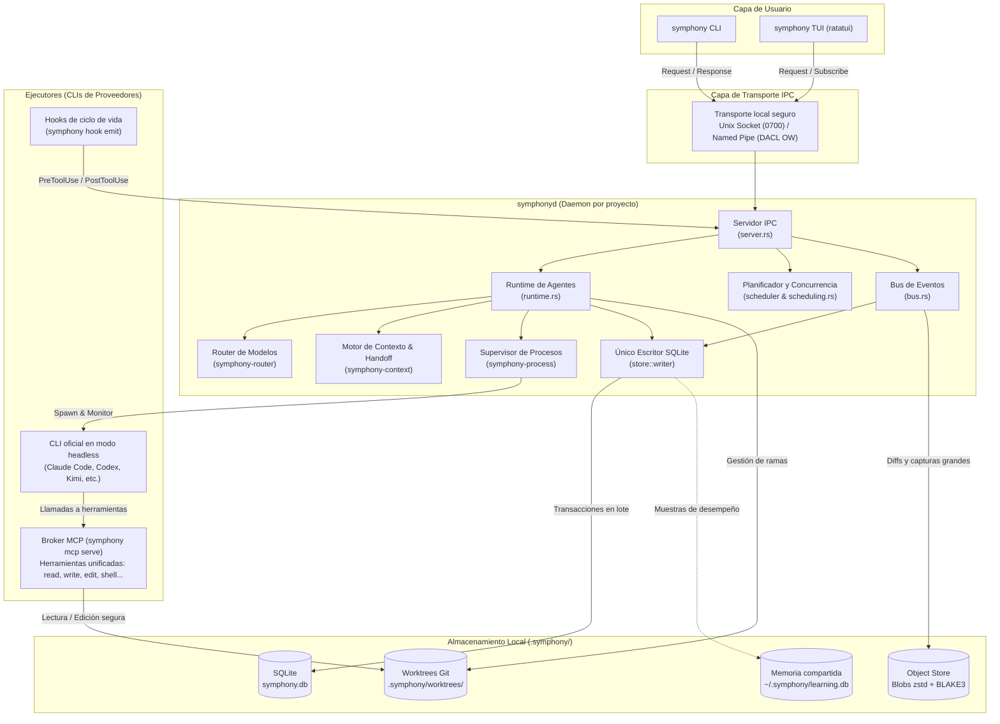

# Arquitectura

Symphony está diseñado como un **runtime local y determinista** concebido para coordinar múltiples asistentes de código basados en inteligencia artificial (Claude Code, Codex, Kimi Code, GitHub Copilot CLI, OpenCode y Antigravity) de forma concurrente, garantizando aislamiento de trabajo, persistencia robusta y continuidad entre diferentes proveedores.

---

## 1. Principio rector: el agente no es el modelo (`AGENT ≠ MODEL`)

El principio fundamental que articula toda la arquitectura de Symphony (ADR-0004, IDEA §2) es la disociación entre **agente** y **modelo**:

- **Agente (`Agent`):** es una entidad persistente y duradera. Posee una tarea asignada, un árbol de trabajo propio (`git worktree`), una rama Git aislada, un historial de eventos, hechos consolidados del proyecto y una secuencia continua de checkpoints incrementales.
- **Modelo / Ejecutor (`Model / Executor`):** es el proceso CLI concreto y el modelo de lenguaje que ejecuta el trabajo en un instante determinado. Es un recurso fungible y efímero representado en la base de datos por una fila en `agent_runs`.

Si un proveedor agota su cuota, sufre caídas de red o si el usuario decide alternar a un modelo más potente o económico, Symphony suspende o detiene el ejecutor activo, consolida el último checkpoint a partir del estado vivo del worktree (`git diff` y archivos modificados) y reanuda la tarea con otro proveedor en el mismo worktree mediante un paquete de handoff de contexto estructurado, sin pérdida de trabajo y sin necesidad de volver a explicar la tarea.

---

## 2. Modelo de procesos

El sistema se estructura en tres niveles de procesos bien diferenciados que colaboran mediante mecanismos de comunicación interproceso (IPC) locales y seguros:

```
┌────────────────────────────────────────────────────────┐
│                   symphony (CLI / TUI)                  │
│       - Comandos de línea clap                         │
│       - Interfaz interactiva TUI (ratatui)             │
│       - Broker de herramientas MCP (symphony mcp serve) │
└───────────────────────────┬────────────────────────────┘
                            │
                            │ IPC (framing longitud + JSON)
                            │ Unix Domain Socket / Windows Named Pipe
                            ▼
┌────────────────────────────────────────────────────────┐
│                  symphonyd (Daemon)                    │
│             (Una instancia por proyecto)                │
│                                                        │
│  ├─ Servidor IPC (server.rs)                           │
│  ├─ Runtime de agentes (runtime.rs)                    │
│  ├─ Supervisor de procesos (crates/process)            │
│  ├─ Bus de eventos (bus.rs)                            │
│  ├─ Motor de contexto (crates/context)                 │
│  ├─ Router determinista de modelos (crates/router)     │
│  ├─ Planificador de recursos y tareas (scheduling.rs)  │
│  └─ Hilo escritor exclusivo SQLite (store::writer)     │
└───────────────┬──────────────────────────┬─────────────┘
                │                          │
        Supervisión de procesos    Inyección de MCP
        Streams stdout/stderr      y Hooks de ciclo de vida
                │                          │
                ▼                          ▼
┌────────────────────────────────────────────────────────┐
│             CLIs oficiales de proveedores              │
│   (Claude Code, Codex, Kimi, Copilot, OpenCode, ...)   │
│                                                        │
│  - Corren en modo headless en su propio worktree       │
│  - Herramientas nativas apagadas (harness unificado)   │
│  - Conectados a symphony mcp serve vía stdio           │
│  - Emiten telemetría local vía symphony hook emit      │
└────────────────────────────────────────────────────────┘
```

### Proceso `symphony` (CLI y TUI)
Es el punto de entrada para el usuario. Se distribuye como binario ejecutable y cumple tres funciones:
1. **CLI:** procesa subcomandos puntuales (`symphony spawn`, `symphony status`, `symphony diff`, etc.) y los envía al daemon mediante IPC.
2. **TUI interactiva:** si se invoca sin argumentos en una terminal interactiva, levanta una interfaz visual completa construida sobre `ratatui` (vistas de agentes, chat de proyecto, proveedores, Centro de Recuperación y configuraciones).
3. **Broker de herramientas MCP (`symphony mcp serve`):** cuando un CLI de IA arranca dentro de un worktree, Symphony le inyecta un servidor MCP por stdio que suministra el conjunto unificado de herramientas de edición y contexto de Symphony (ADR-0019).

### Proceso `symphonyd` (Daemon por proyecto)
Es el núcleo del runtime. Se ejecuta en segundo plano como daemon independiente por cada proyecto abierto (ADR-0018). Mantiene el estado en memoria, supervisa el ciclo de vida de los agentes, administra las transacciones hacia la base de datos SQLite mediante un único hilo escritor, encola operaciones que consumen recursos de máquina (compilaciones, ejecuciones de pruebas) y retransmite eventos en tiempo real hacia los clientes conectados. Si `symphony` detecta que el daemon de un proyecto no está activo, lo inicia automáticamente.

### Procesos de los CLIs de proveedores
Symphony no implementa clientes de red directos hacia las APIs de los modelos de lenguaje en el core ni extrae tokens de sesión: ejecuta los binarios oficiales que el usuario ya tiene instalados y autenticados en su sistema (`claude`, `codex`, `kimi`, etc.). Estos corren como procesos hijos supervisados en modo no interactivo (`headless`), aislados dentro de la carpeta del worktree correspondiente a cada agente.

---

## 3. Diagrama general de arquitectura

El siguiente diagrama Mermaid detalla el flujo de información, la separación de responsabilidades y las dependencias entre los componentes de Symphony:



---

## 4. Crates del Workspace y sus responsabilidades

El código de Symphony está dividido en componentes modulares acoplados únicamente a través de contratos estrictos:

| Crate | Directorio | Rol y responsabilidades |
|---|---|---|
| `symphony-protocol` | `crates/protocol` | Definición del protocolo IPC binario. Framing con cabecera de longitud `u32` big-endian, estructuras tipadas `Message` (`Request`, `Response`, `Event`, `Subscribe`), versionado formal y capa de transporte multiplataforma (`transport.rs`). |
| `symphony-core` | `crates/core` | Modelos de dominio y reglas de negocio puras. Definición de enums (`enums.rs`), máquinas y tablas de transición de estados (`transitions.rs`), identificadores ULID, parseo de configuraciones (`config.rs`), redactado de secretos y monitoreo de salud. No realiza operaciones de E/S. |
| `symphony-store` | `crates/store` | Capa de persistencia relacional sobre SQLite. Contiene el hilo escritor exclusivo `writer.rs`, repositorios especializados (`repo.rs`, `context.rs`, `health.rs`) y la lógica de migraciones SQL versionadas (`migrations/`). |
| `symphony-object-store` | `crates/object-store` | Almacenamiento inmutable direccionado por contenido (CAS) para elementos voluminosos (diffs extensos, capturas de pantalla, fragmentos de contexto). Utiliza hashing BLAKE3, compresión zstd y escrituras atómicas. |
| `symphony-git` | `crates/git` | Envoltorio seguro sobre el CLI de Git. Administra la creación, verificación y eliminación de worktrees, diffs, ramas, commits y comprobación de estado. |
| `symphony-process` | `crates/process` | Supervisor de procesos hijos del sistema operativo. Gestiona la invocación no bloqueante, lectura concurrente de flujos stdout/stderr y terminación garantizada de árboles de procesos (*kill-tree*, ADR-0002) mediante Job Objects en Windows y grupos de procesos en Unix. |
| `symphony-adapter-common` | `crates/adapters/common` | Trait común `ProviderAdapter` y utilidades compartidas de detección, normalización de eventos y extracción de errores de los CLIs de IA. |
| Adapters de proveedores | `crates/adapters/*` | Implementaciones específicas de `ProviderAdapter` para cada CLI soportado: `claude`, `codex`, `kimi`, `antigravity`, `copilot` y `opencode` (ADR-0012). |
| `symphony-router` | `crates/router` | Motor determinista de enrutamiento de modelos. Aplica filtros de disponibilidad y calcula puntuaciones ponderadas según perfiles (`@code`, `@fast`, `@review`) sin usar modelos de lenguaje ni introducir latencia (ADR-0016, ADR-0017). |
| `symphony-scheduler` | `crates/scheduler` | Planificador de concurrencia y recursos. Clasifica las operaciones por clases de peso (clases 0 a 4), administra slots para tareas pesadas (pruebas, compilaciones), resuelve el grafo acíclico dirigido (DAG) de dependencias entre tareas y coordina planes por fases (ADR-0011, ADR-0013). |
| `symphony-context` | `crates/context` | Motor de contexto. Ensambla los paquetes de handoff entre agentes y modelos en cuatro modos (`raw`, `safe`, `balanced`, `aggressive`), implementa el esquema de URIs virtuales `ctx://`, fragmentación de archivos y compresores sintácticos basados en AST mediante tree-sitter (niveles L0 a L5). |
| `symphony-daemon` | `crates/daemon` | Binario `symphonyd` y orquestación general. Conecta el servidor IPC (`server.rs`), el runtime de ejecución (`runtime.rs`), el ejecutor de procesos (`executor.rs`) y el bus de eventos (`bus.rs`). |
| `symphony-tui` | `crates/tui` | Interfaz interactiva de terminal basada en `ratatui`. Modelo de arquitectura desacoplada: estado y lógica pura en `app.rs`, renderizado en `ui.rs` y cliente asíncrono IPC en `io.rs`. |
| `symphony-cli` | `crates/cli` | Binario ejecutable `symphony`. Manejo de comandos con `clap`, broker MCP (`mcp.rs`, `harness.rs`), asistente de inicialización y utilidades de migración. |
| `symphony-testkit` | `crates/testkit` | Entorno de pruebas de integración. Proporciona el binario `fake-agent` para simular respuestas deterministas de proveedores en pruebas L2 sin gastar cuota de suscripción. |

---

## 5. Invariantes del sistema

La estabilidad de Symphony reposa sobre una serie de invariantes estrictas verificadas de manera continua por la suite de pruebas:

1. **Un solo escritor de SQLite (`store::writer`):**
   Toda mutación de la base de datos se canaliza a través de un único canal acotado hacia un hilo dedicado que ejecuta transacciones por lotes (`batch transactions`). El daemon y las vistas de consulta abren conexiones de solo lectura directas, lo que garantiza lecturas no bloqueantes y previene errores de contención (`database is locked`). Ningún proceso ajeno a `symphonyd` interactúa directamente con la base de datos.
2. **Un worktree independiente por agente:**
   Cada agente opera de forma exclusiva en su propio directorio de trabajo Git bajo `<proyecto>/.symphony/worktrees/<agent_id>`. Dos agentes nunca comparten el mismo directorio ni modifican el árbol de trabajo principal del usuario.
3. **Checkpoints continuos y proactivos:**
   El progreso de un agente no se registra únicamente cuando finaliza o cuando ocurre un fallo imprevisto. Symphony genera checkpoints incrementales de forma continua (tras cada invocación de herramienta, turno o evento relevante). Esto permite alimentar en tiempo real el Centro de Recuperación (*Recovery Center*) y retomar cualquier tarea interrumpida sin retrocesos.
4. **Estado persistente independiente de la memoria del modelo (`STATE ≠ MODEL MEMORY`):**
   La fuente de verdad del proyecto reside en Symphony (SQLite + Git + almacén de objetos). El contexto conversacional del CLI es solo una proyección temporal que puede descartarse o reconstruirse en cualquier momento.
5. **Determinismo en la ruta crítica:**
   El router de modelos, el planificador de operaciones, los filtros de salud y los compresores de contexto aplican reglas matemáticas y de configuración auditables. Ninguna función básica del runtime depende de modelos de lenguaje ni realiza telemetría externa.
6. **Integridad de ejecución en runtime:**
   El código en producción no utiliza llamadas a `unwrap()`, `expect()` ni genera `panic!` no controlados. Todas las condiciones de error se modelan mediante tipos `Result` y enumeraciones descriptivas estructuradas con `thiserror`.

---

## 6. Estado y daemon aislados por proyecto (ADR-0018)

A partir de la versión 1.0 (ADR-0018), Symphony organiza todo el estado de trabajo de forma local e independiente en cada repositorio, eliminando el modelo de daemon global monolítico:

```
<proyecto>/
├── .symphony/
│   ├── project.toml       # Configuración específica del proyecto (comiteable en Git)
│   ├── symphony.db        # Base de datos SQLite del proyecto (agentes, tareas, chat, hechos)
│   ├── objects/           # Almacén de objetos content-addressed (diffs, snapshots zstd)
│   ├── worktrees/         # Worktrees aislados asignados a los agentes activos
│   ├── logs/              # Registros de stdout/stderr de las ejecuciones del proyecto
│   └── run/
│       ├── symphonyd.sock # Socket IPC del daemon de este proyecto (en Unix)
│       ├── symphonyd.pid  # Identificador de proceso del daemon activo
│       └── symphonyd.lock # Lock de instancia exclusivo
└── ... (archivos del repositorio del usuario)
```

### Separación entre proyecto y usuario
- **En el proyecto (`<proyecto>/.symphony/`):** se mantiene toda la información propia del trabajo: agentes, historial de tareas, worktrees, base relacional, capturas y el chat persistente (`symphony/chat`). Un archivo `.gitignore` generado automáticamente excluye todo el contenido de `.symphony/`, excepto `project.toml`.
- **En el entorno global del usuario (`~/.symphony/`):** únicamente se almacena la configuración personal (`config.toml`), credenciales de proveedores, plugins globales y skills compartidas.
- **Aprendizaje compartido (`~/.symphony/learning.db`):** para preservar las ventajas del aprendizaje entre proyectos (ADR-0016), las métricas consolidadas sobre el desempeño de modelos y proveedores se sincronizan bidireccionalmente hacia una base global compartida, permitiendo que las decisiones de enrutamiento aprovechen la experiencia previa acumulada.

---

## 7. Harness unificado de Symphony (ADR-0019)

Históricamente, cada CLI oficial imponía sus propias herramientas nativas, distintos niveles de permisos y sandboxes incompatibles (por ejemplo, restricciones dispares al invocar gestores de paquetes o acceder a subdirectorios).

Para resolver esta fragmentación, Symphony implementa un **harness unificado** (ADR-0019):

1. **Broker de herramientas unificado:** `symphony mcp serve` actúa como servidor de protocolo Model Context Protocol (MCP) estándar a través de stdio para los ejecutores.
2. **Conjunto idéntico de capacidades:** todos los modelos compatibles reciben el mismo repertorio de herramientas:
   - `read`: lectura de archivos con soporte para rangos de líneas.
   - `write`: creación o sobrescritura completa de archivos.
   - `edit`: reemplazo exacto de fragmentos de texto contiguos.
   - `glob`: búsqueda de archivos por patrones comodín.
   - `grep`: búsqueda de patrones y expresiones regulares en el código.
   - `shell`: ejecución controlada de comandos en el entorno del worktree.
   - `skill`: invocación de skills registradas.
   - `task`: delegación de subtareas a nuevos subagentes gestionados por Symphony.
   - `context_*`: herramientas de búsqueda y recuperación en el índice de contexto del proyecto (`ctx://`).
3. **Desactivación de herramientas nativas:** durante el lanzamiento del CLI, Symphony desactiva las herramientas nativas del proveedor mediante sus modificadores oficiales de configuración (por ejemplo, `--disallowedTools` en Claude Code, argumentos `-c` en Codex o `--deny-tool` en Copilot), garantizando que todos los modelos operen bajo la misma interfaz y con idénticos permisos de ejecución.
4. **Harness parcial:** aquellos proveedores cuyo CLI no permite desactivar herramientas nativas o inyectar servidores MCP por argumentos sin alterar archivos de configuración globales persistentes (como Antigravity) son catalogados como de *harness parcial*, indicándolo de forma transparente en `symphony providers`.
